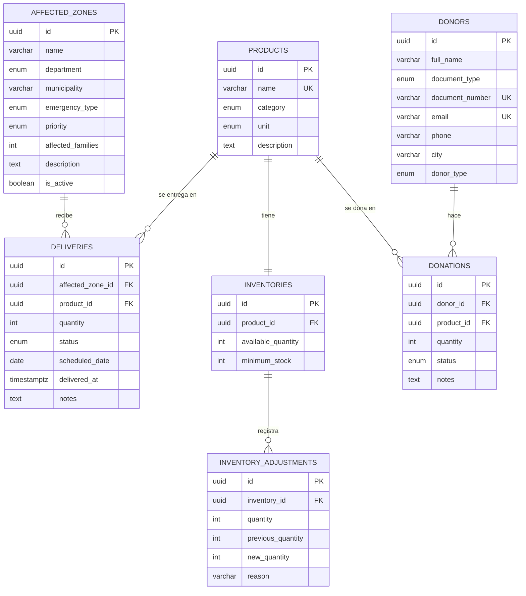

# DonaGest API

API REST para gestionar donaciones humanitarias dirigidas a comunidades colombianas afectadas por emergencias. Permite registrar zonas afectadas y donantes, recibir donaciones de productos, controlar el inventario y programar entregas según la prioridad de cada zona.

---

## 1. Problemática

Colombia enfrenta cada año emergencias que dejan a miles de familias sin vivienda, agua o alimentos:

- **Inundaciones** en La Mojana (Sucre) y el Bajo Cauca, cuando se desbordan los ríos San Jorge y Cauca.
- **Deslizamientos** en zonas de ladera de Antioquia y Risaralda durante las temporadas de lluvia.
- **Sequía** en La Guajira, donde las comunidades wayuu se quedan sin agua potable.
- **Incendios forestales** en épocas secas.
- **Desplazamiento forzado** en Chocó, Cauca y el Catatumbo por el conflicto armado.
- **Sismos** en distintas regiones del país.

En estas situaciones llegan muchas donaciones, pero es difícil saber qué hay en bodega, qué se prometió a cada zona y qué zonas todavía no han recibido nada. DonaGest centraliza esa información: registra quién dona, cuánto hay disponible y a dónde se envía, y evita que se comprometa más de lo que realmente existe en inventario.

---

## 2. Tecnologías

| Tecnología | Uso |
|---|---|
| NestJS 12 + TypeScript 6 | Framework de la API |
| PostgreSQL 16 (Docker) | Base de datos |
| TypeORM 1.x | Entidades, relaciones y transacciones |
| @nestjs/config | Variables de entorno |
| class-validator / class-transformer | Validación de los datos que llegan |
| @nestjs/swagger | Documentación en `/api/docs` |
| Jest + Supertest | Pruebas unitarias y e2e |
| Prettier + oxlint | Formato y revisión del código |

---

## 3. Arquitectura y carpetas

Cada módulo sigue la misma separación:

- **Controller**: define las rutas y delega.
- **Service**: tiene las reglas del negocio y el acceso a datos.
- **DTOs**: validan lo que llega.
- **Entities**: definen las tablas.

```text
DonaGest/
├── docker-compose.yml               # PostgreSQL 16 (contenedor donagest-db)
├── .env-example                     # Variables de entorno de ejemplo
├── docs/
│   └── DonaGest.postman_collection.json
├── test/                            # Pruebas e2e (Jest + Supertest)
└── src/
    ├── main.ts                      # Arranque y Swagger
    ├── app.setup.ts                 # Prefijo, CORS, validación y filtro de errores
    ├── app.module.ts
    ├── config/database.config.ts    # Conexión a PostgreSQL con ConfigService
    ├── database/seeds/seed.ts       # Datos iniciales
    ├── common/                      # Paginación, filtro de errores, pipes y helpers
    ├── affected-zone/               # Zonas afectadas
    ├── donor/                       # Donantes
    ├── product/                     # Productos
    ├── inventory/                   # Inventario, alertas y ajustes
    ├── donation/                    # Donaciones e historial por donante
    ├── delivery/                    # Entregas y entregas por zona
    ├── report/                      # Reportes
    └── health/                      # Estado de la API y la base de datos
```

Cada módulo de negocio tiene `dto/`, `entities/`, `enums/` y sus archivos `*.controller.ts`, `*.service.ts` y `*.module.ts`.

Para que no haya dependencias circulares, las rutas que cruzan módulos viven en el módulo que tiene los datos:

- `GET /donors/:id/donations` está en el módulo de donaciones.
- `GET /affected-zones/:id/deliveries` está en el módulo de entregas.

### Diagrama entidad-relación



Todas las tablas tienen `created_at` y `updated_at`.

---

## 4. Requisitos

- Node.js 24 o superior (NestJS 12 se publica como ESM y se carga con `require`).
- npm 10 o superior.
- Docker y Docker Compose.

---

## 5. Base de datos con Docker

```bash
cp .env-example .env
docker compose up -d
docker ps --filter name=donagest-db   # debe decir (healthy)
```

`docker-compose.yml` levanta `postgres:16-alpine` en el contenedor `donagest-db`, con un volumen (`donagest_data`) y un healthcheck. El usuario, la clave, la base de datos y el puerto salen del archivo `.env`.

**Si el puerto 5432 está ocupado** (por ejemplo, porque ya tienen PostgreSQL instalado en Windows), cambien el puerto en `.env`:

```env
DB_PORT=5433
```

Docker publica la base en ese puerto y la API se conecta al mismo.

Para empezar con la base de datos limpia:

```bash
docker compose down -v && docker compose up -d
```

---

## 6. Variables de entorno

| Variable | Ejemplo | Descripción |
|---|---|---|
| `PORT` | `3000` | Puerto de la API |
| `DB_HOST` | `localhost` | Host de PostgreSQL |
| `DB_PORT` | `5432` | Puerto de PostgreSQL (usar `5433` si el 5432 está ocupado) |
| `DB_USERNAME` | `donagest` | Usuario |
| `DB_PASSWORD` | `donagest` | Contraseña |
| `DB_NAME` | `donagest_db` | Base de datos |
| `DB_SYNCHRONIZE` | `true` | Crea y actualiza las tablas al arrancar (solo para desarrollo) |

El archivo `.env` no se sube al repositorio.

---

## 7. Instalación y ejecución

```bash
npm ci
npm run build
npm run lint
npm run start:dev
```

- API: http://localhost:3000/api/v1
- Swagger: http://localhost:3000/api/docs

| Script | Para qué sirve |
|---|---|
| `npm run start:dev` | Levanta la API y la reinicia con cada cambio |
| `npm run build` / `npm run start:prod` | Compila y ejecuta la versión compilada |
| `npm run lint` | Revisa el código con oxlint (falla también con warnings) |
| `npm run format` | Formatea con Prettier |
| `npm run seed` | Carga los datos iniciales |
| `npm run test` / `npm run test:e2e` | Pruebas unitarias / e2e |

---

## 8. Datos iniciales (seed)

```bash
npm run seed
```

El seed usa los mismos services de la API, así que respeta todas las validaciones y mueve el inventario como lo haría un usuario. Se puede correr varias veces sin duplicar datos. Carga:

- **4 zonas afectadas**:
  - San Marcos, Sucre (inundación, CRITICA)
  - Uribia, La Guajira (sequía, ALTA)
  - Quibdó, Chocó (desplazamiento, ALTA)
  - Dosquebradas, Risaralda (deslizamiento, MEDIA)
- **4 donantes**: una fundación, una empresa y dos personas naturales.
- **6 productos**: agua potable, arroz, kit de aseo, cobijas, suero oral y ropa infantil.
- **6 donaciones**: suman al inventario. La ropa infantil queda en alerta de stock.
- **2 entregas**: una ENTREGADA en San Marcos y una PROGRAMADA para Uribia.

---

## 9. Swagger y Postman

- **Swagger**: http://localhost:3000/api/docs. Todos los endpoints están agrupados por módulo, con ejemplos y códigos de respuesta.
- **Postman**: importar `docs/DonaGest.postman_collection.json` (formato v2.1).
  - `baseUrl` = `http://localhost:3000/api/v1`.
  - Hay una carpeta por módulo, con casos de éxito y de error (400, 404 y 409).
  - Se ejecuta en orden con el *Collection Runner*: cada request guarda los ids que necesitan los siguientes.
  - Se puede correr varias veces, porque los datos únicos usan una variable `runId` que se renueva en el primer request.

---

## 10. Endpoints

Todas las rutas usan el prefijo `/api/v1`. Los listados son paginados con `page` (por defecto 1) y `limit` (por defecto 10, máximo 100) y responden `{ data, meta: { total, page, limit, totalPages } }`.

### Zonas afectadas

| Método | Ruta | Descripción | Códigos |
|---|---|---|---|
| POST | `/affected-zones` | Registrar una zona | 201, 400 |
| GET | `/affected-zones` | Listar con filtros `department`, `priority`, `emergencyType`, `isActive` (de CRITICA a BAJA) | 200, 400 |
| GET | `/affected-zones/:id` | Consultar una zona | 200, 400, 404 |
| PUT | `/affected-zones/:id` | Reemplazar todos los datos | 200, 400, 404 |
| PATCH | `/affected-zones/:id` | Actualizar algunos datos | 200, 400, 404 |
| PATCH | `/affected-zones/:id/status` | Activar o desactivar | 200, 400, 404 |
| DELETE | `/affected-zones/:id` | Eliminar (si no tiene entregas) | 204, 404, 409 |
| GET | `/affected-zones/:id/deliveries` | Entregas de la zona | 200, 400, 404 |

### Donantes

| Método | Ruta | Descripción | Códigos |
|---|---|---|---|
| POST | `/donors` | Registrar un donante | 201, 400, 409 |
| GET | `/donors` | Listar con `search` (nombre, documento o correo) y `donorType` | 200, 400 |
| GET | `/donors/:id` | Consultar un donante | 200, 400, 404 |
| PUT | `/donors/:id` | Reemplazar todos los datos | 200, 400, 404, 409 |
| PATCH | `/donors/:id` | Actualizar algunos datos | 200, 400, 404, 409 |
| DELETE | `/donors/:id` | Eliminar (si no tiene donaciones) | 204, 404, 409 |
| GET | `/donors/:id/donations` | Historial de donaciones | 200, 400, 404 |

### Productos

| Método | Ruta | Descripción | Códigos |
|---|---|---|---|
| POST | `/products` | Registrar un producto (crea su inventario en 0) | 201, 400, 409 |
| GET | `/products` | Listar con `category` y `search` | 200, 400 |
| GET | `/products/out-of-stock` | Productos con inventario en 0 | 200 |
| GET | `/products/:id` | Consultar un producto con su inventario | 200, 400, 404 |
| PUT | `/products/:id` | Reemplazar todos los datos | 200, 400, 404, 409 |
| PATCH | `/products/:id` | Actualizar algunos datos | 200, 400, 404, 409 |
| DELETE | `/products/:id` | Eliminar con su inventario (si no tiene donaciones ni entregas) | 204, 404, 409 |

### Inventario

| Método | Ruta | Descripción | Códigos |
|---|---|---|---|
| GET | `/inventory` | Inventario de todos los productos | 200 |
| GET | `/inventory/alerts` | Productos en el stock mínimo o por debajo | 200 |
| GET | `/inventory/product/:productId` | Inventario de un producto | 200, 400, 404 |
| PATCH | `/inventory/:id/minimum-stock` | Cambiar el stock mínimo | 200, 400, 404 |
| PATCH | `/inventory/:id/adjust` | Ajuste manual con motivo obligatorio | 200, 400, 404, 409 |

### Donaciones

| Método | Ruta | Descripción | Códigos |
|---|---|---|---|
| POST | `/donations` | Registrar una donación (suma al inventario) | 201, 400, 404 |
| GET | `/donations` | Listar con `donorId`, `productId` y `status` (más recientes primero) | 200, 400 |
| GET | `/donations/summary` | Total donado por producto | 200 |
| GET | `/donations/:id` | Consultar una donación | 200, 400, 404 |
| PATCH | `/donations/:id/cancel` | Anular (descuenta del inventario) | 200, 400, 404, 409 |

### Entregas

| Método | Ruta | Descripción | Códigos |
|---|---|---|---|
| POST | `/deliveries` | Programar una entrega (descuenta del inventario) | 201, 400, 404, 409 |
| GET | `/deliveries` | Listar con `affectedZoneId`, `productId`, `status`, `from` y `to` | 200, 400 |
| GET | `/deliveries/upcoming` | Entregas programadas de hoy a 7 días | 200 |
| GET | `/deliveries/:id` | Consultar una entrega | 200, 400, 404 |
| PATCH | `/deliveries/:id/status` | Cambiar el estado | 200, 400, 404 |

### Reportes y salud

| Método | Ruta | Descripción | Códigos |
|---|---|---|---|
| GET | `/reports/summary` | Resumen general de la operación | 200 |
| GET | `/reports/zones/:id` | Resumen de una zona | 200, 400, 404 |
| GET | `/reports/top-donors` | Los 5 donantes con más unidades donadas | 200 |
| GET | `/reports/inventory-by-category` | Unidades disponibles por categoría | 200 |
| GET | `/reports/zones-without-deliveries` | Zonas activas sin entregas | 200 |
| GET | `/health` | Estado de la API y de la base de datos | 200, 503 |

---

## 11. Reglas de negocio

1. **Inventario automático**: al crear un producto se crea su inventario con 0 unidades y stock mínimo de 10. Si se borra el producto, se borra su inventario.
2. **Todo o nada**: registrar o anular una donación, programar o cancelar una entrega y hacer un ajuste manual se hacen en una transacción. Si algo falla, no se guarda nada.
3. **Stock nunca negativo**: la fila del inventario se bloquea (`pessimistic_write`) mientras se modifica. Si dos pedidos llegan al mismo tiempo, uno espera al otro y no se descuenta de más. Si no alcanza, responde 409 `Stock insuficiente: disponible X, solicitado Y`.
4. **Donaciones**:
   - Máximo 10.000 unidades por donación.
   - Solo se anulan las RECIBIDAS.
   - No se eliminan, para conservar el historial.
5. **Entregas**:
   - La zona debe existir y estar activa.
   - La fecha no puede estar en el pasado (se usa la hora de Colombia).
   - El stock se descuenta al programar.
6. **Estados de entrega** (definidos en `delivery/constants/delivery-status-transitions.ts`):
   - PROGRAMADA → EN_TRANSITO o CANCELADA
   - EN_TRANSITO → ENTREGADA o CANCELADA
   - ENTREGADA y CANCELADA son finales.

   Al pasar a ENTREGADA se guarda `deliveredAt`; al CANCELAR el stock vuelve al inventario. Cualquier otro cambio responde 400.
7. **Datos únicos**: documento y correo del donante, y nombre del producto (sin importar mayúsculas).
8. **Validaciones colombianas**:
   - Departamento: uno de los 32 departamentos más Bogotá D.C.
   - Celular: 10 dígitos que empiezan por 3.
   - Documento según su tipo: CC y CE de 6 a 10 dígitos; NIT de 9 dígitos con dígito de verificación opcional; pasaporte de 6 a 10 letras o números.
9. **Ajustes manuales**: requieren un motivo de al menos 5 caracteres y quedan registrados en `inventory_adjustments`.

---

## 12. Códigos HTTP y errores

| Código | Cuándo |
|---|---|
| 200 | Consulta o actualización correcta |
| 201 | Registro creado |
| 204 | Registro eliminado |
| 400 | Datos inválidos, id que no es UUID, transición de estado no permitida, fecha pasada o zona inactiva |
| 404 | El registro no existe |
| 409 | Dato repetido, registro relacionado con otros datos o stock insuficiente |
| 503 | La base de datos no responde (`/health`) |

Los errores tienen este formato y los mensajes están en español:

```json
{
  "statusCode": 409,
  "error": "Conflict",
  "message": "Stock insuficiente: disponible 180, solicitado 500"
}
```

El filtro global `TypeOrmExceptionFilter` traduce los errores de PostgreSQL:

- `23505` → 409 "El registro ya existe".
- `23503` → 409 "No se puede completar la operación porque el registro está relacionado con otros datos".

---

## 13. Flujo de Git

- Ramas: `main` ← `develop` ← `feature/*` y `fix/*`.
- Cada funcionalidad tiene su propia rama `feature/*` que sale de `develop` y vuelve a `develop` con un Pull Request revisado por otro integrante.
- Commits con *Conventional Commits* en español, en minúscula e imperativo. Por ejemplo: `feat(donor): agregar búsqueda de donantes por nombre o documento`.
- La versión estable pasa de `develop` a `main` con un PR de release y se marca con un tag (`v1.0.0`).

---

## 14. Integrantes

| Integrante | Usuario de GitHub | Responsabilidad |
|---|---|---|
| maajjjoo | [@maajjjoo](https://github.com/maajjjoo) | Configuración base, zonas afectadas y donantes |
| Josecampoe | [@Josecampoe](https://github.com/Josecampoe) | Productos, inventario y donaciones |
| Daniel-I24 | [@Daniel-I24](https://github.com/Daniel-I24) | Entregas, reportes, salud, datos iniciales y documentación |
